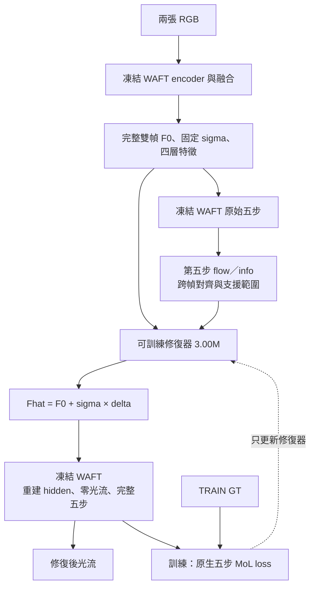

# 凍結 WAFT 的光流特徵修復

**保持完整 WAFT 凍結，以原生五步光流損失訓練外接的特徵修復模型。**

目前主流程使用 **3,000,576 個參數**的 motion-aligned 修復器。它讀取 WAFT 原始雙幀特徵、
同次 encoder 的四層特徵，以及原始 WAFT 第五步的 flow／info；預測特徵修正量後，
重新執行同一個凍結 WAFT 的完整五步光流估計。訓練梯度經過 WAFT 回到修復器，
只有修復器參數會更新。



GT 只用於訓練損失與評估。推論需要兩張 RGB、官方 WAFT 權重與修復器權重，
不讀取 GT、target features 或配對 Clean。此流程沒有 DINOv3，也不需要先製作昂貴特徵教師。

## 安裝

以下為已核對的 Python 3.10／PyTorch 2.5.1 環境：

```bash
git clone https://github.com/cactus8603/roco_main.git
cd roco_main
python3.10 -m venv .venv
source .venv/bin/activate
python -m pip install --upgrade pip setuptools wheel
python -m pip install torch==2.5.1 torchvision==0.20.1 --index-url https://download.pytorch.org/whl/cu124
python -m pip install -e ".[dev,waft]"
python -m pip install -r requirements/native-flow.txt
```

目前修復器是 convolutional 模型，不需要 Mamba／causal-conv1d extension。
小尺寸 CPU 驗證可改裝對應 CPU PyTorch；完整影像訓練建議使用 CUDA。

準備固定的官方原碼：

```bash
git clone https://github.com/princeton-vl/WAFT.git external/WAFT
git -C external/WAFT checkout b152ff1cad1af8c185ee7b141997c48ff3334c87
```

從 [WAFT 官方下載資料夾](https://drive.google.com/drive/folders/1joBWKGoH2RUdCgcge8Tz2osOHcQUX5m_?usp=sharing)
取得 **a2／DAv2／vits、Chairs+Things source-only `zero-shot.pth`**，
存為 `checkpoints/waft/zero-shot.pth`，再核對：

```bash
waft-repair doctor --waft-source external/WAFT \
  --waft-checkpoint checkpoints/waft/zero-shot.pth
```

程式核對固定原碼、checkpoint SHA-256 與完整 508 個 WAFT tensors，不另行下載 encoder 權重。
資料集、官方權重與訓練後修復器權重不包含在 repository。

## KITTI：資料、訓練、續訓、推論

先將 KITTI 2015 解壓到 `data/kitti/training`，包含 `image_2` 與 `flow_occ`。
以下命令使用公開的固定 [160 TRAIN／40 dev ID](examples/native/kitti-split.json)：

```bash
waft-repair native-split-kitti --kitti-root data/kitti \
  --output outputs/kitti-spec

waft-repair native-prepare --spec outputs/kitti-spec/images.json \
  --output outputs/kitti-inputs --device cuda:0 \
  --waft-source external/WAFT --waft-checkpoint checkpoints/waft/zero-shot.pth

waft-repair native-train --manifest outputs/kitti-inputs/manifest.json \
  --output outputs/native-repair --epochs 32 --device cuda:0 \
  --waft-source external/WAFT --waft-checkpoint checkpoints/waft/zero-shot.pth
```

`native-prepare` 快取原始輸入、encoder observations 與 baseline 對齊依據，不訓練修復器。
`native-train` 每次由修復特徵重建 hidden，完整執行五步，使用原生 MoL loss。
160 筆、32 epochs、batch 1 共 5,120 次修復器更新；dev 不參與更新，最終使用固定第 32 epoch。

若中斷，沿用原本清單、設定與輸出目錄：

```bash
waft-repair native-train --manifest outputs/kitti-inputs/manifest.json \
  --output outputs/native-repair --epochs 32 --device cuda:0 \
  --resume outputs/native-repair/checkpoint.pt \
  --waft-source external/WAFT --waft-checkpoint checkpoints/waft/zero-shot.pth
```

對兩張新影像推論：

```bash
waft-repair native-infer --repair-checkpoint outputs/native-repair/model.pt \
  --image1 data/first.png --image2 data/second.png \
  --output outputs/prediction.npz --device cuda:0 \
  --waft-source external/WAFT --waft-checkpoint checkpoints/waft/zero-shot.pth
```

NPZ 保存原尺寸最終 flow 及五步 flow／info。完整評估、資料格式、續訓規則與小尺寸驗證見
[原生光流訓練完整指南](docs/native-training.md)。命令以前景方式執行，不建立背景訓練服務。

## 模型與證據範圍

模型輸出為 `F0 + sigma × (global + centered_spatial)`，修正量無硬式幅度界限。
它能拆解全域與空間修正，但 delta 大小、對齊差異與原生 info 並非經校準的錯誤機率，
也不能單憑熱圖判定錯誤原因。

目前公開的是正在使用的模型與可獨立執行的 pipeline。固定 KITTI 160／40 的第 16 epoch
評估中，逐影像平均 EPE 為 TRAIN `2.9495 → 1.2575`、dev `4.6323 → 3.5196`。
這是中途 checkpoint 的監測結果，不是固定第 32 epoch 的最終結論。
dev 已被歷史研究使用，不是官方隱藏 KITTI test，也不代表全專案從未曝光資料。
詳細範圍與限制見 [結果文件](docs/results.md)。

## 文件

- [完整執行指南](docs/native-training.md)：安裝、固定 split、快取、訓練、續訓、評估與影像推論。
- [整體架構](docs/architecture.md)：特徵介面、座標對齊、凍結與梯度。
- [修復模型](docs/feature-repair.md)：四層特徵、motion prior、global／spatial delta 與 loss。
- [命令與資料格式](docs/usage.md)：目前 API、manifest 與 checkpoint。
- [結果與限制](docs/results.md)：中途模型觀察、歷史結果及成本定義。
- [歷史 target-feature MSE 流程](docs/legacy-running.md)：較早的 3.92M 模型及離線 target 訓練。
- [歷史 target 製作](docs/targets.md)、[資料清單](docs/data-inventory.md)：既有教師資料與本機存放盤點。

目前主流程不使用歷史 target-feature MSE 訓練；兩者的模型權重與 checkpoint 格式不能互換。
