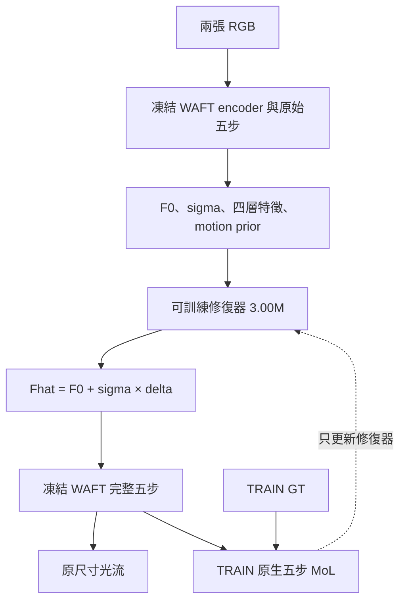

# 凍結 WAFT 的光流特徵修復

以原生五步 MoL loss 訓練 **3,000,576 參數**的 motion-aligned 修復器，完整 WAFT 保持凍結。
提供 KITTI 單卡及 Sintel Clean＋Final 雙卡訓練、完整 checkpoint 接續與兩張 RGB 推論。
GT 僅進入訓練損失與評估；修復器讀取原始 F0、sigma、同次 encoder 四層特徵及原始第五步 motion prior。



## 安裝

已核對 Python3.10／PyTorch2.5.1。記憶體釋放流程使用 Linux／glibc。

```bash
git clone https://github.com/cactus8603/roco_main.git
cd roco_main
python3.10 -m venv .venv
source .venv/bin/activate
python -m pip install --upgrade pip setuptools wheel
python -m pip install torch==2.5.1 torchvision==0.20.1 --index-url https://download.pytorch.org/whl/cu124
python -m pip install -e ".[dev,waft]"
python -m pip install -r requirements/native-flow.txt
git clone https://github.com/princeton-vl/WAFT.git external/WAFT
git -C external/WAFT checkout b152ff1cad1af8c185ee7b141997c48ff3334c87
```

從 [WAFT 官方資料夾](https://drive.google.com/drive/folders/1joBWKGoH2RUdCgcge8Tz2osOHcQUX5m_?usp=sharing)
取得 a2／DAv2／vits 的 `kitti.pth`、`sintel.pth` 或 source-only `zero-shot.pth`。
loader 同時核對完整檔案 SHA256 與全部508個 tensors；資料、權重及實驗產物由使用者另行準備。
不需額外 DINOv3 或 Mamba extension，也不會另下載 encoder 權重。

## KITTI：50 epochs，單卡

```bash
waft-repair native-split-kitti --kitti-root data/kitti --output outputs/kitti-spec
MALLOC_ARENA_MAX=2 waft-repair native-prepare \
  --spec outputs/kitti-spec/images.json --output outputs/kitti-inputs --device cuda:0 \
  --waft-source external/WAFT --waft-checkpoint checkpoints/waft/kitti.pth
MALLOC_ARENA_MAX=2 waft-repair native-train \
  --manifest outputs/kitti-inputs/manifest.json --output outputs/kitti-repair \
  --epochs 50 --warmup-updates 160 --device cuda:0 \
  --waft-source external/WAFT --waft-checkpoint checkpoints/waft/kitti.pth
```

固定160 TRAIN／40已曝光dev，batch1，共8000次更新，最終固定E050。
輸入 cache 綁定所選官方底模；換底模時使用新的輸入目錄。

## Sintel：80 epochs，雙卡

```bash
waft-repair native-split-sintel --sintel-root data/sintel --output outputs/sintel-spec
CUDA_VISIBLE_DEVICES=0,1 MALLOC_ARENA_MAX=2 OMP_NUM_THREADS=2 \
  torchrun --standalone --nnodes=1 --nproc-per-node=2 --module waft_repair \
  --threads 2 native-train-ddp --spec outputs/sintel-spec/images.json \
  --output outputs/sintel-repair --epochs 80 --warmup-updates 796 \
  --waft-source external/WAFT --waft-checkpoint checkpoints/waft/sintel.pth
```

18 TRAIN／5 dev場景，兩種 rendering 使用相同場景分割；TRAIN1592、dev490。
每卡1筆、global batch2、共63680次同步更新。每次從 RGB 重建原始特徵、baseline與prior，
DDP 將兩個局部 loss 的梯度平均一次，再做 FP64 clipping 和 AdamW；不讀取教師特徵。

## 記憶體、接續與驗證

每筆完成並刪除暫存 tensor 後，同步 CUDA、清除閒置 pinned-host cache、執行 `malloc_trim`，
再對已使用的自有檔案給予唯讀 `POSIX_FADV_DONTNEED` 建議。輸入內容與有效模型狀態保持原值。
記憶體紀錄寫入 `memory-boundaries.jsonl` 或 `memory-rank0/1.jsonl`；既有服務與系統資源設定由執行環境管理。

中斷後沿用原命令與設定，加上 `--resume outputs/.../checkpoint.pt`。
雙卡 checkpoint 保存完整修復器、AdamW、scheduler、資料游標與兩個 rank 各自的完整 RNG；
僅恢復已提交的更新。程式驗證兩份 repair／AdamW replica 完全相同後才保存。
固定 checkpoint 評估不以 dev-best 選點；不自動延長排程或重啟工作。

```bash
python -m pytest tests/waft_repair -q
```

測試涵蓋數值損失、凍結／梯度界線、唯讀記憶體處理、兩個真實 CPU Gloo 程序的梯度平均、
完整 AdamW／每rank RNG恢復，以及雙卡入口的短程停止與接續。CPU fixtures 不代表完整影像 CUDA 速度或 EPE。

[完整操作指南](docs/native-training.md)列出權重雜湊、雙卡接續、評估人口與資源設定範圍。
[架構](docs/architecture.md)、[修復模型](docs/feature-repair.md)、[命令格式](docs/usage.md)與
[結果及限制](docs/results.md)保留方法與證據定義。

先前 source-only KITTI第16epoch的已曝光dev監測結果，與目前官方底模的50／80epoch訓練分開記錄。
目前正式長程訓練仍在進行；尚無這兩條長程訓練的最終EPE結論。
[歷史 target-feature MSE 流程](docs/legacy-running.md)另有模型與checkpoint格式。
