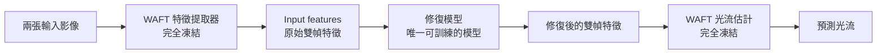

# WAFT 特徵修復

**保持 WAFT 完全凍結，只訓練一個接在特徵中間的修復模型。**

兩張輸入影像先經過 WAFT 的特徵提取器，得到 input features；修復模型將它們修正後，
再送回同一個 WAFT 的光流估計部分，得到最終光流。
修復模型的訓練目標是預先製作的 target features，提供便宜與昂貴兩種製作方式。



圖中的兩個 WAFT 區塊屬於**同一個預訓練 WAFT**。特徵提取、後續更新與光流讀出
的權重全部固定；訓練只改變修復模型的權重。

## 先跑通安裝、訓練與推論

以下命令使用 Python 3.10。CPU 範例使用小型合成特徵，不需要 GPU 或官方權重：

```bash
git clone https://github.com/cactus8603/roco_main.git
cd roco_main
python3.10 -m venv .venv
source .venv/bin/activate
python -m pip install --upgrade pip setuptools wheel
python -m pip install torch==2.5.1 --index-url https://download.pytorch.org/whl/cpu
python -m pip install -e ".[dev]"
waft-repair demo --output outputs/cpu-example --epochs 10
```

成功後會保存修復模型 `outputs/cpu-example/training/checkpoint.pt`、訓練指標與
`outputs/cpu-example/repaired-features.pt`。這是程式通路驗證，未載入 WAFT，也不代表光流效果。

**實際影像的完整流程請接著看 [從安裝到訓練與影像推論](docs/running.md)**：
包含 CUDA 環境、官方權重、KITTI／Sintel GT 轉換、便宜／昂貴 target、訓練與兩張影像推論。
完整模型與流程程式在 [`src/waft_repair`](src/waft_repair)。

## 訓練時，target 從哪裡來？

Target features 是希望修復模型學到的特徵，利用訓練資料的真實光流（GT）離線製作。
每筆資料保留原始 input features，以及由下列其中一種方法製作的 target features。

| Target 版本 | 如何製作 | 主要計算成本 |
|---|---|---|
| **便宜版：非遮擋區 RGB 重建** | 用 GT 找到第二張影像的對應位置，重建第一張影像的可見區，再經凍結的 WAFT 特徵提取器 | 已快取 target 來源影像對的特徵時，額外編碼一張影像；不做反向傳播或逐筆最佳化 |
| **昂貴版：直接最佳化特徵** | 固定 WAFT，逐筆調整特徵，使 WAFT 最後輸出的光流更接近 GT | 可選 32、256、512 次特徵最佳化，預設 512；每次通過完整 WAFT 光流估計 |

兩者都是**離線監督訊號**。修復模型每次訓練使用已選定版本的 target，
不依每筆 GT 分數挑選兩版中較好的結果。

昂貴版以 `--target-steps` 選擇每筆特徵最佳化步數，例如：

```bash
waft-repair prepare --spec examples/repair/images.json \
  --target expensive --target-steps 32 --output outputs/expensive-32-features \
  --waft-source external/WAFT --waft-checkpoint checkpoints/waft/zero-shot.pth \
  --device cuda:0
```

將 `32` 改為 `256` 或 `512` 即可；省略此選項時仍使用 512。
這是外層 AdamW 的更新次數，WAFT 內部始終完整執行 5 次更新。
各版本都保留原始 F0，選取預算內最早達到嚴格最低 EPE 的候選；
其餘最佳化設定、±0.25σ 限制與品質判準相同。
不同步數請使用不同輸出目錄。便宜版不使用此選項。

## 三個階段

1. **準備資料**：用凍結 WAFT 抽取原始 input features，另外製作便宜或昂貴的 target features。
2. **訓練修復模型**：輸入原始特徵，輸出修復特徵，以它與 target 的特徵誤差更新修復模型。
3. **推論與評估**：將修復特徵送回凍結 WAFT，從零光流開始執行完整 5 次更新，輸出光流。

目前修復訓練使用預存特徵的均方誤差；光流評估是另一個步驟。
推論只需要影像、凍結 WAFT 與已訓練修復模型，**不需要 GT、target features 或逐筆特徵最佳化**。

## 目前已確認的結果

下表是將**便宜 target 直接送回 WAFT**的結果，用來檢驗訓練目標的品質。
EPE 是預測光流與 GT 的平均向量距離，單位為像素，越低越好。

| 訓練資料 | 原始特徵 EPE | Target 特徵 EPE | 降幅 |
|---|---:|---:|---:|
| KITTI，160 對 | 2.9495 | 2.5192 | 14.59% |
| Sintel Clean，100 對 | 1.5620 | 1.1450 | 26.69% |
| Sintel Final，100 對 | 5.1144 | 1.1450 | 77.61% |

Sintel Final 的便宜 target 由**對應 Clean 的完整雙幀影像**製作，修復模型的輸入仍是原 Final 特徵。
昂貴版另有兩筆完整核驗的個案，詳見結果文件。

**修復模型已實作，學習後的光流改善仍待完整驗證。**
上表是訓練資料上的 target 品質，不能當作修復模型的效果或未見資料的泛化結果。

## 從這裡繼續閱讀

- [整體架構](docs/architecture.md)：特徵在哪裡取出、在哪裡放回，以及哪些部分凍結。
- [修復模型](docs/feature-repair.md)：模型輸入輸出、局部與跨幀修復、訓練損失。
- [兩種 target 的製作方法](docs/targets.md)：RGB 重建、特徵最佳化與各資料集的來源。
- [結果與驗證範圍](docs/results.md)：完整統計、退步案例數與證據資料。
- [資料存放清單](docs/data-inventory.md)：實際磁碟路徑、原始資料、features、targets 與修復輸出。
- [程式使用方式](docs/usage.md)：目前公開的 target API、外部依賴與測試方法。

本 repository 已提供修復模型、target 製作、資料清單核驗、訓練／續訓與影像推論程式。
資料集、官方 WAFT 權重與訓練後的修復權重需另行準備；程式不會自動啟動背景工作。

