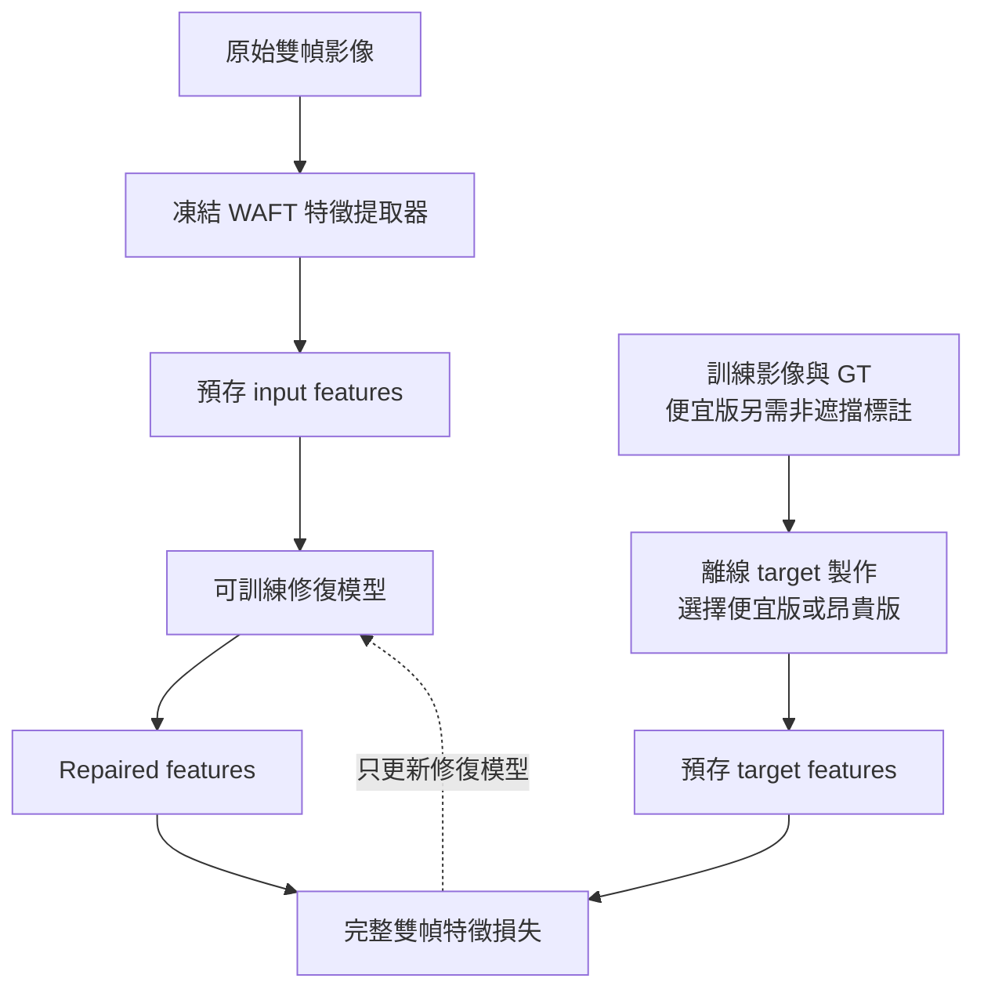
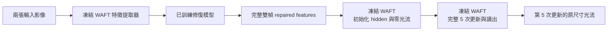

> 歷史版本：本頁記錄較早的 target-feature MSE 修復流程，使用 3,923,200 參數模型。
> 目前的 3,000,576 參數原生光流訓練，請看 [完整指南](native-training.md)。
> 歷史頁面的狀態描述不代表目前訓練狀態。

# 整體架構

本專案在完整凍結的 WAFT 中間加入一個可訓練修復模型：
先取出兩張影像的原始特徵，修復後再送回同一個 WAFT，繼續完成光流估計。

## 三種特徵

| 名稱 | 意義 | 使用時機 |
|---|---|---|
| Input features | 凍結 WAFT 從原始輸入影像提取的雙幀特徵 | 訓練與推論，作為修復模型輸入 |
| Target features | 利用訓練 GT 離線製作，希望模型學到的雙幀特徵 | 只用於訓練監督與 target 品質檢驗 |
| Repaired features | 修復模型由 input features 預測的雙幀特徵 | 送回 WAFT 產生光流 |

Target 有便宜與昂貴兩種製法；兩者都對應同一個 WAFT 特徵介面。
Repaired features 是模型預測值，品質需另外以最終光流驗證。

## 訓練流程



目前以預存的 input 與 target 進行特徵監督訓練。
修復模型的訓練過程不需要執行 WAFT，也沒有從光流損失經 WAFT 傳回修復模型的梯度。

## 推論流程



推論不讀取 GT 或 target，也不執行便宜／昂貴 target 製作。

## 特徵取出與放回的位置

取出位置沿用官方 WAFT 的完整特徵前處理：

```text
輸入 RGB → 影像正規化 → 邊界填補 → encoder 與 fnet 融合 → 通道投影
```

得到的特徵形狀為 `[batch, 2, 64, padded_height/2, padded_width/2]`。
`2` 表示兩個影格，每格有 64 個通道。邊界填補使影像尺寸符合 WAFT 的計算需求；
這些填補區域也會影響後續光流計算。

修復模型處理並輸出**完整雙幀特徵，包含所有填補區域**。
將輸出放回 WAFT 時，必須在 hidden 初始化之前注入，再從零光流執行全部 5 次更新。
原始特徵、target 與修復特徵的品質評估皆使用相同接入位置和更新次數。

## 完全凍結代表什麼？

- WAFT 所有參數固定，包含特徵提取器、迭代模組與光流讀出。
- WAFT 保持評估模式，不加入修復模型的 optimizer。
- 修復模型訓練只更新修復模型自己的參數。
- 昂貴 target 製作會經 WAFT 計算特徵的梯度，但仍只更新該筆資料的特徵變量。

因此，昂貴 target 製作需要反向傳播，與 WAFT 權重是否凍結是兩件不同的事。

## 資料集的輸入與 target 來源

| 資料 | Input features 來源 | 便宜 target 的影像來源 | 昂貴 target 起點 |
|---|---|---|---|
| KITTI | 原 KITTI 雙幀影像 | 同一 KITTI 雙幀影像 | 原 KITTI 特徵 |
| Sintel Clean | 原 Clean 雙幀影像 | 同一 Clean 雙幀影像 | 原 Clean 特徵 |
| Sintel Final | 原 Final 雙幀影像 | **對應 Clean 的完整雙幀影像** | **原 Final 特徵** |

Final 的便宜監督使用配對 Clean；推論仍以 Final 影像作為輸入，不需要取得 Clean。
製作這類訓練 target 時，必須確認 Clean／Final 的影像配對、GT、有效像素與尺寸一致。

接著閱讀：[修復模型](legacy-feature-repair.md) · [Target 製作](targets.md)。
